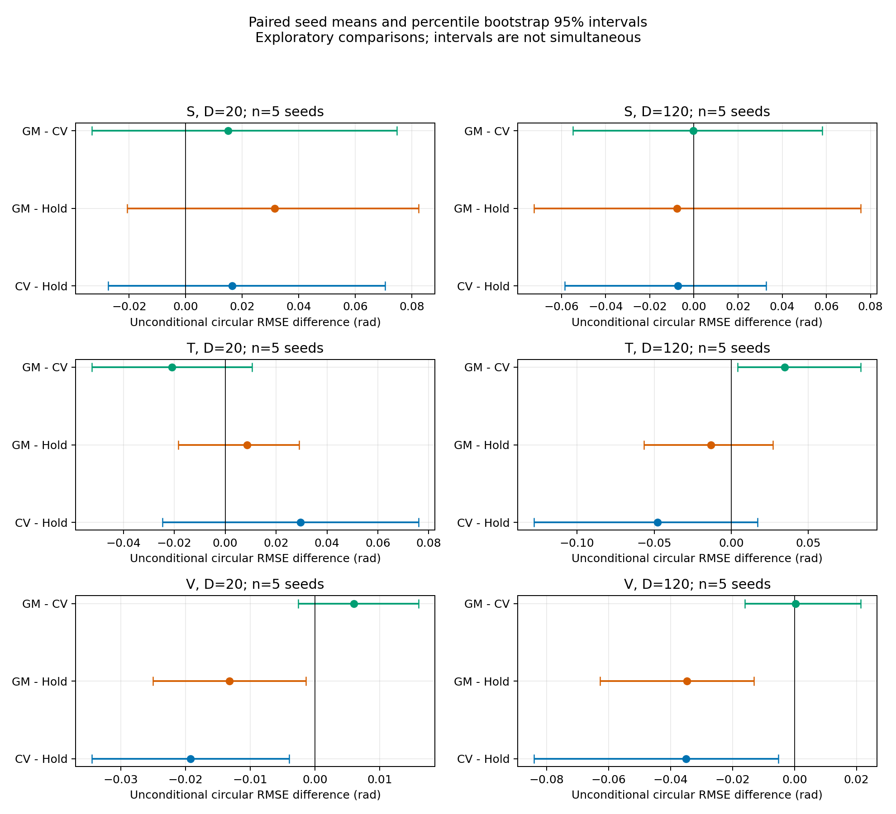

# P2 开环诊断报告

## Material Passport

日期：2026-11-02。研究问题：同一真实方位、同一带噪观测和相同缺失掩码下，默认KF是否优于最后观测保持？证据：**探索性开发集，5个复用种子**。代码基线：`Hao_L@c0ab184`。AGY实现回放、分析和初始测试；Codex审核修正、生成物理输入、执行与独立复核。P3–P5未执行，未调整现有控制器。

## 结论与下一步判断

预测优势取决于运动状态，不能把P1中“GO未明显提高”简单归因为KF一概不准。本轮默认KF-CV在快方位变化层V的短、长遮挡均比Hold有较小的圆周RMSE；慢变化层S及受控转向层T的配对区间跨零，尚无清晰的稳定优势。KF-GM的默认协方差偏窄，不能把持续输出解释成更可靠。

另一个重要来源是二维周期边界的最小镜像切换：少量入边跨越半场距离后，定义出的真实方位会突然跳变，形成大误差尾部。这与持续转向的动力学失配不同，必须分开诊断；本轮保留全部样本，并附按镜像切换边分层的描述性检查。

**推荐优先做后续P2校准与几何分层，暂不扩大闭环扫描。** 在连续方位变化与最小镜像切换条件分开后，评估Q/角速度模型的校准；再决定是否对V类工况进入P3固定输入回放。不能在本轮验证数据上挑选“最佳Q”并回写原结论。

## 实际设计与完整性

5个seed为2026110101–2026110105，沿用P1开发集。N=20、神经元100、k=15、每观察者遮挡循环ID前7条入边（140条有向边，index-fixed），dt=0.3、测量标准差0.01rad、R=1e-4rad²。物理及神经参数保持P1配置。

每个seed复用一条完整P1 Fresh轨迹，并新生成一条受控转向Fresh轨迹，合计10条物理记录。物理参考没有遮挡，估计器输出不反馈运动；只有离线观测序列被人工掩码。转向刺激：1401步起，20个个体、幅度0.06、速率0.02rad/模型时间、持续400步，基准方向来自该seed刺激前的实际航向。刺激前完整神经/物理状态与传感随机源逐点匹配；刺激后相对无刺激组的航向RMS变化为0.445–1.138rad，说明实际运动确有改变。

S/V按无刺激轨迹中1201:20:1681候选起点后120步的真值方位差分RMS选择最小/最大，平局最早，完全不读取估计器表现。T固定起点1401。慢/转向/快层平均方位差分RMS分别约0.083/0.140/0.189rad/模型时间。S的平均GO约0.346，仅是相对慢层，**不是已经证明稳定直行的高有序集群**。选择全表与起点已保存。

15个片段×D={20,120}步，共30个回放条件；每条件同时运行Hold、KF-CV、KF-GM。每次从第1步预热，保存预200步、遮挡D步、恢复400步的全部预测。S/V复用物理轨迹、两种D共享前缀，均不增加独立样本量。5条新转向轨迹生成成功；30个回放条件0跳过、0失败。

KF-CV使用q=1e-4；KF-GM使用仓库默认q=1e-5、tau=10。两者q不同，表中比较代表各自默认配置整体差异，不能仅归因于模型结构。未扫描、优化或挑选参数。

## 遮挡期预测误差

单位均为rad。每个seed先对D×140条边时刻计算圆周RMSE，再跨5个seed平均；表中是这些seed级RMSE的均值，而非将所有帧当独立样本后求区间。

| 层 | D（步） | Hold | KF-CV | KF-GM |
|---|---:|---:|---:|---:|
| S：相对慢变化 | 20 | 0.1137 | 0.1302 | 0.1452 |
| S：相对慢变化 | 120 | 0.3907 | 0.3834 | 0.3830 |
| T：受控转向 | 20 | 0.1447 | 0.1743 | 0.1534 |
| T：受控转向 | 120 | 0.5698 | 0.5221 | 0.5567 |
| V：相对快变化 | 20 | 0.2010 | 0.1818 | 0.1878 |
| V：相对快变化 | 120 | 0.6542 | 0.6192 | 0.6194 |

主要比较为同seed `RMSE_KF-CV − RMSE_Hold`，负值表示改善。以下为10000次按seed成组重采样的百分位95%区间，固定随机种子2026110200。

| 层 | D | 平均配对差 | 95%区间 |
|---|---:|---:|---|
| S | 20 | +0.01644 | [-0.02735, +0.07054] |
| S | 120 | -0.00727 | [-0.05858, +0.03276] |
| T | 20 | +0.02959 | [-0.02465, +0.07601] |
| T | 120 | -0.04769 | [-0.12799, +0.01714] |
| V | 20 | -0.01920 | [-0.03446, -0.00395] |
| V | 120 | -0.03499 | [-0.08409, -0.00528] |

V层的KF-GM−Hold差分别为-0.01320和-0.03473，区间分别[-0.02501,-0.00139]、[-0.06276,-0.01309]。其余对比、所有seed原值及完整精度见`analysis/contrasts.csv`和`grouped.csv`。18个分层方法对比均如实保留；区间没有多重比较同时覆盖保证，n=5且病例由开发轨迹分层，因此即使某些区间未跨零也只是探索性信号，不能升级为独立验证。

## 协方差、创新与门限

长遮挡D=120时，KF-CV的近似95%覆盖在S/T/V层分别为97.52%/95.48%/93.79%；KF-GM仅85.84%/78.70%/78.63%。GM长期平均P约0.00888rad²，CV约0.43669rad²。未出现近似区间半宽达到pi的情况，但圆周跳变与厚尾仍使高斯区间的可靠性受限。

观测前缀平均NIS：CV在S/T/V为21.97/18.23/17.71，GM为41.14/33.41/32.33，远高于独立正确高斯模型下均值1的参考。R与传感噪声方差实际匹配；不能仅凭这些均值把失配全部归于传感噪声或连续转向，镜像方位跳变和时间相关性也有影响。另附逐时间NIS和圆周误差分布，避免覆盖率均值掩盖少量大误差。

CV在第101个缺失步首次P>1，D=120最后20步全部被部署方差门限截断，即140条隐藏边的16.67%边时刻；GM和Hold本轮不触发门限。最大观测年龄36模型时间，未达到age>120。**主要RMSE包含截断后的原始预测**，没有删去困难时刻；有效子集RMSE仅作补充。P2未执行神经输入或部署控制，不得把此处active标签解释成实际闭环补偿收益。

## 几何跳变的补充检查

S/T/V在120步窗口分别有15/28/47个最小镜像切换边时刻；接近Nyquist的方位差分分别2/4/8个。这些是5seed合计描述性计数，不是独立重复次数，也不能据此恢复未采样的真实角速度。

在本次窗口内从未切换最小镜像的边上，V层短遮挡的Hold/CV平均RMSE为0.0910/0.0665，长遮挡为0.4402/0.3913；含切换边的误差常达到约1.5–1.7rad。该补充检查支持将几何不连续和连续运动分别研究；它没有改变病例选择、总体主比较或技术排除规则。分层不是随机操纵，不能视为已证明的因果分解。

## 验证、文件和研究边界

- 11/11软件测试通过，包括首帧缺失、隐藏观测污染、未来观测污染不影响过去输出、包角、初始化、age单位、Joseph协方差和门限。
- 独立原版MATLAB对照：3类片段×2个D×2滤波器×3条边，每边2200步；最大方位差9.70e-14rad，P11差1.11e-16，NIS绝对差3.27e-11。
- 10个输入的SHA、140条边、病例选择与噪声配对核验通过。位置独立复算方位最大差1.13e-15rad。
- 独立从30个原始NPZ复算270行汇总、6300行年龄RMSE、30行配对差和36行bootstrap汇总，全部通过。所有原始预测协方差最小特征值约6.43e-6。
- 7张主分析图及3张审核补充图均已生成并检查；CSV、冻结源码、协议、软件失败日志及审核记录完整保留。

结果目录：[完整P2结果](../../effective-social-input/results/kf-p2-v1-20261102-reviewed/)。复现入口：[README.md](README.md)。`source_hashes.json`冻结运行代码；`input_manifest.json`记录上游P1 MAT与新输入SHA；`raw/replay/manifest.json`记录30个预测文件SHA。独立审计位于`review/`。

本次只新增P2脚本和新结果，未修改main、原始模型、P1或历史结果。适合以探索性P2诊断归档到Hao_L；尚不建议作为新预测器进入正式闭环。公共回退使用本次发布提交的`git revert`，不删除历史结果。
